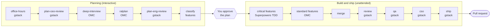

# AI Software Team

**One goal in, a reviewed, tested and security-audited pull request out.**

AI Software Team is a [Claude Code](https://claude.com/claude-code) workspace that runs
three open-source agent toolkits as a single software team:

- [gstack](https://github.com/garrytan/gstack) reviews the product, the plan, the code,
  and the security, then ships.
- [oh-my-claudecode](https://github.com/Yeachan-Heo/oh-my-claudecode) (OMC) fills
  requirement gaps, plans, and builds standard features in parallel.
- [Superpowers](https://github.com/obra/superpowers) builds critical features
  test-first.

You describe what to build and approve the plan. The team builds the rest without
stopping, then opens a pull request for you to merge.

```text
 you write a goal ─► planning (interactive) ─► you approve the plan ─► build, review, QA, security, ship (unattended) ─► PR
```

---

## Contents

- [Features](#features)
- [How it works](#how-it-works)
- [Requirements](#requirements)
- [Installation](#installation)
- [Quick start](#quick-start)
- [Usage](#usage)
- [Writing a goal](#writing-a-goal)
- [Critical vs standard features](#critical-vs-standard-features)
- [The unattended half](#the-unattended-half)
- [Keeping the tools up to date](#keeping-the-tools-up-to-date)
- [Project layout](#project-layout)
- [Troubleshooting](#troubleshooting)
- [Contributing](#contributing)
- [Acknowledgements](#acknowledgements)
- [License](#license)

## Features

- **One command, full pipeline.** `scripts/devteam.sh goal.md` takes a goal from
  product review to an open PR, in 15 ordered phases.
- **Clear ownership.** Each phase belongs to exactly one tool, and only one tool drives
  at a time. The rules live in [CLAUDE.md](CLAUDE.md).
- **Risk-aware building.** Features that can lose money, leak data or break security
  are built test-first, each in its own git worktree. Everything else is built fast,
  in parallel.
- **Interactive where it matters.** You answer product and requirement questions and
  approve the plan once. After that the run needs nobody.
- **Resumable.** Progress is saved to `.devteam/state.json`. Stop at any point, rerun
  the same command, and it carries on where it stopped.
- **Self-maintaining.** A weekly job updates the prerequisites and all three tools,
  smoke-tests them, and rolls back the tools if anything breaks.

## How it works



| # | Phase | Owner | What happens |
| --- | --- | --- | --- |
| 1 | intake | devteam | The goal is saved to `.devteam/goal.md` and a run starts |
| 2 | office-hours | gstack | Pressure-tests the idea: demand, users, scope |
| 3 | plan-ceo-review | gstack | Founder-level review; settles what is in v1 |
| 4 | deep-interview | OMC | Asks only about requirements still unclear (skipped if none) |
| 5 | ralplan | OMC | Consensus implementation plan (planner, architect, critic) |
| 6 | plan-eng-review | gstack | Locks architecture, edge cases and the test plan |
| 7 | classify | devteam | Every feature marked critical or standard in `.devteam/features.md` |
| 8 | **approve-plan** | **you** | **The only stop: approve the plan and the critical list** |
| 9 | build-critical | Superpowers | Each critical feature test-first in its own git worktree |
| 10 | build-standard | OMC | Standard features via `/team` (parallel) or `/autopilot` |
| 11 | merge | devteam | Critical branches merged, full test suite green |
| 12 | review | gstack | Code review of the whole diff |
| 13 | qa | gstack | End-to-end testing; fixes what breaks |
| 14 | cso | gstack | Security audit; high and critical findings fixed |
| 15 | ship | gstack | Version, changelog, push the branch, open the PR |

## Requirements

- [Claude Code](https://claude.com/claude-code) with a plan that can run long sessions
- macOS, Linux (Debian/Ubuntu, RHEL family, Fedora, Arch, openSUSE, Alpine) or WSL
- Node.js LTS, git, Bun ≥ 1.3.3 and tmux (installed for you, see below)
- The [GitHub CLI](https://cli.github.com) (`gh`), logged in, so `/ship` can open the PR
- Optional: a static-capable C compiler, which gstack's `/cso` needs for its full audit

## Installation

Each teammate does this once.

```bash
# 1. Clone
git clone https://github.com/krishnasai01/AI-Software-Team.git
cd AI-Software-Team

# 2. Prerequisites: detects your OS, installs whatever is missing, prints versions
scripts/setup-prereqs.sh

# 3. gstack (global install, as its README describes)
git clone --single-branch --depth 1 https://github.com/garrytan/gstack.git ~/.claude/skills/gstack
(cd ~/.claude/skills/gstack && ./setup --team --no-skill-routing)

# 4. Open Claude Code in the repo and accept the project plugins (OMC, Superpowers)
claude

# 5. Log in to GitHub for /ship
gh auth login

# 6. Check everything loads
scripts/smoke-test.sh
```

The OMC and Superpowers plugins are enabled in the repo's `.claude/settings.json`, so
Claude Code offers to install them the first time it opens the project.

> **tcsh/csh users:** Bun's installer only edits bash, zsh and fish startup files. Add
> `set path = ( $HOME/.bun/bin $path )` to `~/.cshrc`.

## Quick start

```bash
cp templates/goal-template.md my-goal.md      # fill it in
scripts/devteam.sh my-goal.md --dry-run       # preview the phases; changes nothing
scripts/devteam.sh my-goal.md                 # run it
```

Answer the planning questions and approve the plan. The rest runs by itself and ends
with a PR link.

## Usage

```text
scripts/devteam.sh <goal-file | "goal text"> [options] [-- <claude args>]
```

| Command | What it does |
| --- | --- |
| `scripts/devteam.sh my-goal.md` | Start a run from a goal file |
| `scripts/devteam.sh "a todo app with login"` | Start a run from a sentence |
| `scripts/devteam.sh my-goal.md --dry-run` | Print every phase with its owner; write nothing |
| `scripts/devteam.sh` | Resume the current run |
| `scripts/devteam.sh --status` | Show the run's progress |
| `scripts/devteam.sh --new other-goal.md` | Archive the current run and start a new one |
| `scripts/devteam.sh my-goal.md -- --model sonnet` | Pass options to Claude Code |
| `/devteam my-goal.md` | Same as the launcher, from inside Claude Code |

**Choosing a model:** a full run uses many tokens. Start with Sonnet
(`-- --model sonnet`) and move to a larger model only if the results need it.

**Small jobs** such as a bug fix or a question don't need the pipeline. Just ask Claude
Code in this repo; [CLAUDE.md](CLAUDE.md) tells it which tool owns the work.

## Writing a goal

Start from [templates/goal-template.md](templates/goal-template.md):

| Section | What to put there |
| --- | --- |
| Product summary | What it is and why it exists, in a few sentences |
| Users | Who uses it and what they need |
| Features | Everything v1 should do |
| Critical features | The features that must not break (optional; inferred if empty) |
| Tech stack | Languages, frameworks, hosting, constraints |
| Acceptance criteria | How you will know it works |

The more the goal says, the fewer questions planning asks, and the fewer guesses the
unattended half has to make.

## Critical vs standard features

A feature is **critical** if a bug in it could:

- lose money
- expose or corrupt data
- break security or access control
- violate legal or compliance rules
- cause an irreversible action
- break the product's core value

Critical features are built by Superpowers, test-first (red → green → refactor), one
git worktree each. Everything else is **standard** and built by OMC. If your goal lists
critical features, that list is used; otherwise it is inferred and shown to you at the
approval step.

## The unattended half

Once you approve the plan, phases 9 to 15 run without questions or approval stops:

- Claude starts in the `auto` permission mode, so routine actions don't prompt.
- gstack runs in its no-human mode and takes its recommended option at each decision.
- OMC and Superpowers questions are answered with the recommended option.
- Claude is kept working until the run finishes.

Every decision made on your behalf is logged to `.devteam/artifacts/decisions.md` and
linked from the PR. Nothing is merged into your default branch: merging the PR is
yours.

The run stops early only when it needs something a person must provide, such as a
secret, an API key, a login, a security finding it can't fix, or tests that keep
failing. It then records the phase as **blocked** with the reason.
`scripts/devteam.sh --status` shows what is needed; provide it and run
`scripts/devteam.sh` to resume.

## Keeping the tools up to date

```bash
scripts/update-agents.sh            # update everything, smoke-test, roll back on failure
scripts/smoke-test.sh               # check prerequisites and every pipeline command
```

`update-agents.sh` schedules itself weekly: a systemd user timer on Linux, launchd on
macOS, cron otherwise. If the smoke test fails after an update, gstack, the plugins and
the project's Claude files are restored to their previous versions.

## Project layout

```text
.
├── CLAUDE.md                      # tool-ownership rules (read by Claude every session)
├── WORKFLOW.md                    # full reference: setup, pipeline, maintenance
├── templates/goal-template.md     # start every goal here
├── scripts/
│   ├── setup-prereqs.sh           # install Node.js, git, Bun, tmux
│   ├── devteam.sh                 # launcher, dry run, resume, status
│   ├── update-agents.sh           # weekly update with rollback
│   ├── smoke-test.sh              # does everything load?
│   └── lib/                       # phase list, state helper, shared shell helpers
├── .claude/
│   ├── settings.json              # project plugins and hooks
│   ├── commands/devteam.md        # the /devteam orchestrator
│   ├── hooks/                     # gstack gate, unattended-run hooks
│   └── omc.jsonc                  # OMC settings that keep it in its lane
└── .devteam/                      # run state, artifacts, logs (git-ignored)
```

## Troubleshooting

| Problem | Fix |
| --- | --- |
| A command is missing in Claude Code | `scripts/smoke-test.sh` names it; restart Claude Code after plugin updates |
| gstack skills are blocked | Install gstack (Installation step 3) and make sure `node` is on `PATH` |
| `/cso` says "not assessed" | Run `scripts/setup-prereqs.sh` to install a C toolchain, then rerun gstack's `./setup` |
| Permission prompts during the unattended half | Start with `scripts/devteam.sh`, or press Shift+Tab until auto mode is shown |
| The run is blocked | `scripts/devteam.sh --status` shows why; fix it, then `scripts/devteam.sh` |
| The run blocks at `ship` | Install `gh` and run `gh auth login` |

More in [WORKFLOW.md](WORKFLOW.md#5-troubleshooting).

## Contributing

1. Create a branch off `main`.
2. Keep [CLAUDE.md](CLAUDE.md), [WORKFLOW.md](WORKFLOW.md) and this README in step with
   your change.
3. To add or reorder a phase, edit `scripts/lib/phases.txt`, the single source of
   truth, and its section in `.claude/commands/devteam.md`.
4. Before opening a PR, run:

   ```bash
   bash -n scripts/*.sh
   scripts/devteam.sh templates/goal-template.md --dry-run
   scripts/smoke-test.sh
   ```

## Acknowledgements

This project wires together, and depends on, three MIT-licensed projects:

- [gstack](https://github.com/garrytan/gstack) by Garry Tan
- [oh-my-claudecode](https://github.com/Yeachan-Heo/oh-my-claudecode) by Yeachan Heo
- [Superpowers](https://github.com/obra/superpowers) by Jesse Vincent

They are installed from their own repositories and keep their own licenses; none of
their code is copied into this repo.

## License

No license has been chosen for this repository yet. Until a `LICENSE` file is added,
all rights are reserved by the copyright holder.
